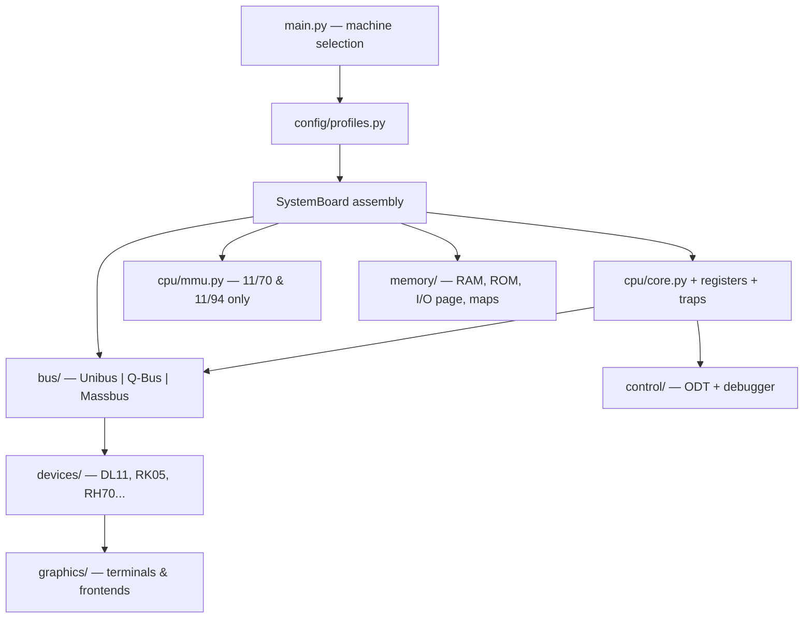

# eleven13 — DEC PDP-11 Emulator — Design Specification

**Project name:** `eleven13` (13 octal = 11 decimal: the machine's number, written in the machine's base). Distribution/CLI name is `eleven13`; the Python package root remains `pdp11` for self-describing imports.

**Target language:** Python 3.11+
**Scope:** Emulation of four machines: **PDP-11/03 (LSI-11)**, **PDP-11/20**, **PDP-11/70**, and **PDP-11/94**, selectable at launch. Modular architecture separating CPU core, memory subsystem, bus emulation, I/O, graphics/terminals, peripherals, and machine profiles.

**Structure:** Part A (§§1–17) is the engineering specification. Part B (§§18–22) is the implementation submission package for Vibe Code: tooling and quality gates, non-negotiable agent conventions, glossary, authoritative references, and the milestone-scoped submission protocol. Where they conflict, Part A wins.

---

## 1. Guiding Principles

1. **Modularity first.** Every functional block (CPU, bus, device) is an independent Python module communicating through well-defined interfaces. A device must never reach into CPU internals directly.
2. **Selectable machine profiles.** A single `MachineProfile` dataclass describes each of the four models (CPU type, bus type, memory size, MMU present, FPU present, default devices). Emulation is assembled from the profile at startup.
3. **Detailed inline documentation.** All code follows a mandatory comment standard (see §10): every module has a docstring header, every class and public method has a docstring, and non-obvious bit manipulation has line comments. PDP-11 documentation convention (octal) is used throughout: all numeric hardware constants are written in octal (`0o...`).
4. **Testability.** The CPU core is a pure state machine (no wall-clock dependence inside the instruction loop), allowing deterministic unit tests against known-good references (e.g., SIMH, DEC diagnostics).

---

## 2. The Four Target Machines

| Property | PDP-11/03 | PDP-11/20 | PDP-11/70 | PDP-11/94 |
|---|---|---|---|---|
| CPU | LSI-11 (KD11-F) | KD11-B (discrete) | KD11-Z | J-11 (DCJ-11) |
| Bus | Q-Bus | Unibus | Unibus + Massbus | Q-Bus (async, Q22-CD) |
| Physical addressing | 18-bit (I/O map) | 16-bit | 22-bit (via Unibus map) | 22-bit |
| MMU | No | No | Yes (kernel/supervisor/user) | Yes (on-chip, 22-bit) |
| FPU | No (unless FPJ11 option) | No | Optional FP11 | FPJ on-chip |
| Commercial instruction set (CIS) | Optional (KEF11) | No | Optional (KH11) | On-chip (J-11 CIS) |
| EIS (MUL/DIV/ASH/ASHC) | Optional (KEF11) | No | Yes | Yes |
| Max memory | 64 KB | 64 KB (56 KB usable) | 4 MB | 4 MB |
| Notes | Microcoded LSI-11 | Original non-microcoded PDP-11 | Cache + Massbus disks | Fastest PDP-11; dual J-11 capable |

**Machine-specific accuracy notes:**

- **11/20:** lacks microcoded instructions introduced with the 11/45 (MUL, DIV, ASH, ASHC, XOR, SOB, MARK, SXT, MTPS/MFPS, SPL). On the KD11-B these opcodes are effectively skipped/no-op'ed rather than trapping — the emulator must reproduce this exactly. No privilege modes, no stack-limit traps.
- **11/03:** microcoded; EIS via KEF11 option; 18-bit extended addressing via the LSI-11 I/O page; Q-Bus DMA, 16-bit only.
- **11/70:** 22-bit physical addressing requires the 11/70 Unibus Map; the MMU provides separate kernel/supervisor/user address spaces of 16 KB each (32 APRs of 32 entries); Massbus via RH70 for RP04/RP06/RP07 disks; MMR0–MMR3 diagnostic registers.
- **11/94 (DCJ-11):** full 22-bit mapping, on-chip CIS and FPU, micro-trap format differences vs earlier models, asynchronous Q-Bus (Q22-CD), fastest of the four.

---

## 3. Package Layout

Codebase root: `pdp11/`

```text
pdp11/
│
├── __init__.py
├── main.py                   # Entry point, CLI, machine selection (argparse)
├── config/
│   ├── __init__.py
│   ├── profiles.py           # MachineProfile dataclass + the 4 profiles
│   └── config.json           # per-run overrides (memory size, devices, volumes)
│
├── cpu/
│   ├── __init__.py
│   ├── core.py               # fetch/decode/execute main loop
│   ├── registers.py          # R0..R7 (R6=SP, R7=PC), PSW model
│   ├── instructions/
│   │   ├── __init__.py
│   │   ├── single_operand.py # CLR, COM, INC, DEC, NEG, TST, ADC, ROR, ...
│   │   ├── double_operand.py # MOV, ADD, SUB, CMP, BIT, BIC, BIS, ...
│   │   ├── branch.py         # BR, BXX conditional branches, SOB, EMT/TRAP
│   │   ├── jump_subroutine.py # JMP, JSR, RTS, MARK, RTI/RTT
│   │   ├── eis.py            # EIS: MUL, DIV, ASH, ASHC (+ FIS: FADD etc.)
│   │   ├── fp11.py           # Floating-point instruction set (11/70 FP11, J-11 FPJ)
│   │   ├── cis.py            # Commercial instruction set (LOCC, SKPC, MOVC string ops)
│   │   └── control.py        # HALT, WAIT, RESET, SPL, MTPS/MFPS, MFPI/MTPI
│   ├── mmu.py                # 11/70/94 MMU: PAR/PDR, MMR0-3, I/D separation
│   ├── fp11.py               # FP11 arithmetic engine (32/64-bit formats, exceptions)
│   ├── interrupts.py         # IPL levels, interrupt scheduling, priority logic
│   └── traps.py              # Trap dispatch, vector lookup, PSW save/restore
│
├── memory/
│   ├── __init__.py
│   ├── ram.py                # Byte/word addressable RAM blocks; speed class per machine
│   ├── rom.py                # Boot/diagnostic ROM (M9312-style boot PROMs)
│   ├── io_page.py            # The top 8 KB I/O page (octal 177600-177777) register file
│   └── map_registers.py      # 11/70 Unibus Map, 11/94 Q-Bus map registers
│
├── bus/
│   ├── __init__.py
│   ├── abstract_bus.py       # BusDevice ABC: read/write/intr/dma interfaces
│   ├── unibus.py             # Unibus: NPR (DMA), BR/BG priority daisy chain
│   ├── qbus.py               # Q-Bus: BIAK/BDMG chains, DMA, 18/22-bit mapping
│   └── massbus.py            # 11/70 Massbus: RH70 + RP/RM disk drives
│
├── devices/
│   ├── __init__.py
│   ├── dl11.py               # DL11 serial line (console DL11-E + extras)
│   ├── dz11.py               # DZ11 8-line multiplexer
│   ├── rk11_rk05.py          # RK05 cartridge disk + RK11 controller
│   ├── rl11.py               # RL01/RL02 disk + RL11 controller
│   ├── rx11.py               # RX01/RX02 floppy + RX11 controller
│   ├── rh70_rp.py            # RH70 Massbus controller + RP04/RP06/RP07
│   ├── tm11.py               # TU10 magnetic tape + TM11 controller
│   ├── tqk11.py              # TK50/TU81 tape via TQK11 (Q-Bus)
│   ├── pc11.py               # Paper tape reader/punch (PC11)
│   ├── kw11l.py              # Line-frequency clock (KW11-L) — all machines
│   └── kw11p.py              # Programmable clock (KW11-P)
│
├── graphics/
│   ├── __init__.py
│   ├── terminal.py           # Abstract terminal frontend interface
│   ├── vt100.py              # VT52/VT100 software terminal emulators (with AVO)
│   ├── la36.py               # LA36 DECwriter rendering
│   ├── framebuffer.py        # Optional VT11-class vector graphics device
│   └── render_backend.py     # Text-grid (curses) backend + optional pixel backend
│
├── disk_images/
│   ├── __init__.py
│   ├── container.py          # Reads/writes SIMH-style disk/tape container formats
│   └── simh_compat.py        # Converter for legacy SIMH container formats
│
├── control/
│   ├── __init__.py
│   ├── front_panel.py        # ODT console + RUN/HALT panel-event semantics (§13)
│   ├── debugger.py           # Breakpoints, tracing, examine/deposit, disassembly
│   ├── snapshot.py           # Save/restore session state (§15)
│   └── rom_loader.py         # Boot ROM image loading (M9312 512-word PROMs)
│
├── system_clock.py           # Deterministic scheduler: bus-cycle counter +
│                              # priority queue of scheduled device events (§5.6)
│
└── tests/
    ├── __init__.py
    ├── cpu_golden.py          # Instruction-level assertions over known bit patterns
    ├── device_unit.py         # Device register/state machine tests, PRNG-seeded
    └── machine_diagnostics.py# Run DEC MAINDEC diagnostics, compare expected output
```

---

## 4. Core Architecture

### 4.1 Launch and Machine Selection

`main.py` provides:

- `--machine {03,20,70,94}` — selects the emulated model. **Required**; no default because behavior differs fundamentally.
- `--memory`, `--disk <image>`, `--console {vt100,vt52,la36,odt}`, `--debug`
- `--config <json>` — fine-grained device/memory overrides layered over the profile.

### 4.2 System Assembly and Control Flow



`SystemBoard` connects CPU + MMU + memory + bus + devices per the profile. Devices communicate exclusively through the bus interface; the CPU core talks to memory and I/O through a single `MemoryInterface`, which switches between flat 16-bit mode (11/03, 11/20) and MMU-mapped 22-bit mode (11/70, 11/94).

---

## 5. CPU Emulation Spec (cpu/)

### 5.1 State

```python
class CPUState:
    R: array of 8 registers (R0-R7; R6=SP, R7=PC) — each a 16-bit unsigned int
    PSW: condition codes N, Z, V, C; trace bit T; priority IPL 0-7;
         current/previous mode (kernel/supervisor/user)
    (11/70 & 11/94 only: separate SP per mode)
    (FPU machines only: AC0-AC5 floating accumulators)
    HALT/Run flag, wait-for-interrupt flag
```

### 5.2 Address Modes (the heart of PDP-11 decoding)

```python
DEC_ADDR_MODE = 0o70  # mask covering mode bits <5:3> of an operand specifier
DEC_REG_NUM   = 0o07  # mask covering register bits <2:0> of an operand specifier

def resolve_operand(state, bus, operand_halfword, is_source, is_byte):
    """
    Evaluate an operand's effective address/absolute value, applying
    auto-increment/decrement, indexing, and indirection relative to Rn or PC.
    The PDP-11 has no separate load/store instructions: every instruction
    embeds its addressing scheme in the operand specifier itself.
    """
    mode = (operand_halfword & DEC_ADDR_MODE) >> 3   # mode 0-7
    reg  = operand_halfword & DEC_REG_NUM             # register 0-7
    ...
```

Address modes (each covered by unit tests; PC-relative quirks are mandatory):

| Mode | Name | Notes |
|---|---|---|
| 0 | Register | operand is in Rn |
| 1 | Register-deferred | (Rn) |
| 2 | Autoincrement | (Rn)+ — PC special-case: immediate literal; byte mode increments by 1 |
| 3 | Autoinc-deferred | @(Rn)+ — PC special-case: absolute address |
| 4 | Autodecrement | -(Rn) — SP: push |
| 5 | Autodec-deferred | @-(Rn) — SP: pop |
| 6 | Index | X(Rn) — PC: relative address, word displacement |
| 7 | Index-deferred | @X(Rn) — PC: relative-deferred |

### 5.3 Instruction Dispatch

`core.py` decodes on opcode bits <15:12> with secondary decode for group 0o07x (JSR/RTS family, MARK, EIS, FIS, CIS, FP11, control). Handlers register via a decorator for testability:

```python
@opcode(0o0701)   # MUL
def instr_MUL(state, bus, src_operand, dest_reg):
    """
    EIS multiply: 32-bit product of R[dest_reg] and src placed in
    R[dest_reg] and R[dest_reg | 1] (when dest_reg is even).
    Signed; sets N/Z/V per the PDP-11 Processor Handbook.
    NOT available on the 11/20 (KD11-B) — see capability matrix.
    """
```

### 5.4 Instruction Capability Matrix

`profiles.py` tags each instruction (`BASE`, `EIS`, `CIS`, `FPU`, `MMU_ONLY`). The CPU checks tags before execute:

- **11/20:** microcoded-only opcodes are consumed as no-ops (advance PC, no trap), matching KD11-B behavior.
- **11/03:** EIS/CIS only when the KEF11 option flag is set in the profile.
- **11/70 / 11/94:** full capability, with FP11 present only if configured (11/70).

### 5.5 Interrupts and Traps

- 8 IPL levels; current priority in PSW; pending projection via `interrupts.py`.
- Interrupts sampled between instructions. Bus (NPR/DMA) requests can steal cycles mid-instruction on Unibus machines — modeled at word-transfer granularity.
- Standard vectors: octal 000004 bus error, 000010 illegal/reserved, 000014 T-bit, 000020 IOT, 000024 power fail, 000030 EMT, 000034 TRAP.
- **Power-fail / power-restore behavior is mandatory, not optional.** Many OSes (RSTS, RSX) depend on the auto-restart sequence: on power-fail the CPU traps through vector 000024 with the warning that at least 2 ms (simulated) of execution time remains before the machine "dies"; on power-restore it restarts through vector 000024 (or from the power-up option) without operator intervention. For the emulator, `--powerfail`/`--powerrestore` debugging commands inject these sequences so the full shutdown/restart code path is testable.
- **Bus-error divergence per machine is specified in the profile, not hard-coded:** Unibus machines (11/20, 11/70) deliver a clean timeout bus error on nonexistent memory access; the 11/03's LSI-11 Q-Bus handling differs (notably for odd-address word access: the LSI-11 word-mode hardware itself tolerates certain odd-word sequences rather than trapping uniformly, and nonexistent-memory behavior differs per backplane configuration). `profiles.py` carries a `bus_error_model` field selecting the exact quirk set, with cross-references to the per-machine errata notes in §13.
- 11/70 MMU abort handling updates MMR0 and pushes PC+PSW; 11/94 micro-trap differences gated by profile.

### 5.6 Clocks and Timing

- A `ClockSource` advances per CPU quantum; the KW11-L line-frequency clock (50/60 Hz) is required on all four machines — RT-11/RSTS depend on it. Devices requiring cycles (tape, disk seeks) model latency in bus ticks rather than wall-clock time.
- **Concrete timing model (binding for implementation and tests):**
  - The quantum is **one bus cycle**, nominally 150 ns on Unibus machines (~300 ns on Q-Bus). Each iteration of the CPU main loop consumes a computed number of bus cycles per instruction (from per-instruction cost tables, documented in `core.py`), then advances the scheduler.
  - The dispatcher in `system_clock.py` maintains a **priority queue of scheduled events**: devices push `(due_cycle, callback)` entries (line-clock tick every 16,667/20,000 cycles, disk-seek completion, tape-remainder gaps, debounced console input). The CPU never polls devices; it drains due queue entries after each instruction.
  - This design is **deterministic by construction** (no wall-clock reads inside the loop), which makes the §11 timing acceptance criteria actually testable and allows fixed-seed replay of any session.
  - Wall-clock throttling (to avoid running a 60 Hz clock at host-CPU speed) exists only at the outer boundary in `main.py`, outside the deterministic core, and is optional wrapping that fixture tests exclude.

### 5.7 MMU (cpu/mmu.py) — 11/70 and 11/94 only

- PAR/PDR fields (PLF, ACF, MR, ED) exposed as bitfield properties; 8 APRs per mode, 3 modes.
- I/D space separation via MMR0 bit 3; instruction fetch must not touch the D-space map.
- 11/70: 22-bit physical via Unibus map ( map registers in `memory/map_registers.py`); Q-Bus machines use BROM-style mapping per profile.

### 5.8 FP11 / FPJ (cpu/fp11.py)

- 32-bit (F) and 64-bit (D) formats, sign-magnitude with excess-128 exponent; instructions: ADDF/D, SUBF/D, MULF/D, DIVF/D, ABS, NEG, CMP, MOD, LDEXP, SETF/SETD/SETI/SETL, CFCC/CLCC, STC*/*LD* accumulator moves, integer conversions.
- Exceptions (reserved operand, overflow, underflow, divide by zero) set V/C and trap per the FP11 manual.
- On machines without FPU, FP opcodes trap as reserved.

---

## 6. Bus Spec (bus/)

### 6.1 BusDevice Interface

```python
class BusDevice(ABC):
    """Anything connected to a bus implements this contract."""
    @abstractmethod
    def read_word(self, addr: int) -> int: ...    # 16-bit bus word read
    @abstractmethod
    def write_word(self, addr: int, val: int): ...
    @abstractmethod
    def read_byte(self, addr: int) -> int: ...    # consoles are byte devices
    @abstractmethod
    def write_byte(self, addr: int, val: int): ...
    def dma_request(self, bus): ...               # NPR/BDMG arbitration, optional
    def interrupt(self, bus, vector, ipl): ...   # BR/BIAK, optional
    def reset(self): ...                          # on CPU RESET (bus init)
```

- **Unibus:** NPR (DMA) outranks BR (interrupt) grants; daisy-chain order implemented as an ordered device list — priority is slot order, as on the real backplane.
- **Q-Bus:** BIAK and BDMG grant chains; 18-bit (11/03) or 22-bit (11/94) system address space via map registers; asynchronous operation on the 11/94.
- **Massbus (11/70):** RH70 controller translates Unibus program I/O to Massbus register space; drives (RP04/RP06/RP07, RM03) attach beneath it.

### 6.2 I/O Page (memory/io_page.py)

- The top 8 KB of the bus address space (octal 177600–177777 region) hosts device control/status registers; devices register address ranges via `attach(start_addr, device)` and the I/O page forwards reads and writes.
- Both word and byte access must pass through intact. Byte access to the low/high half of a register is legal for devices like the DL11; per-register read/write masks are the device's responsibility.

---

## 7. Peripheral Modules (devices/)

**Design rule:** each device driver consists of (a) its CSR/register file exposed through the I/O page, and (b) a `tick()` state machine handling data transfer, error states, and interrupt generation. Every register carries an inline documentation block: reset value, read/write mask, field layout, taken verbatim from DEC's *PDP-11 Peripherals Handbook* as commentary.

Required device set by priority:

| Priority | Device | Machines | Notes |
|---|---|---|---|
| P0 | DL11 console, ODT support, KW11-L clock, RK05/RK11, RX01, TU10/TM11 | all four | Minimum boot set |
| P1 | DZ11, RL01/RL02 + RL11, PC11 paper tape | 03, 70, 94 | |
| P2 | RH70 + RP06/RP07, TU81/TQK11, KW11-P | 70, 94 | |
| P3 | DU11, DP11 and other uncommon DEC gear | on-demand | |

- **The RK05 driver is the reference implementation** for all other device drivers: complete register documentation, transfer timing model, error register behavior, and an end-to-end "boot RT-11 from RK05" transcript in its tests.
- Console terminal traffic flows through `graphics/terminal.py`: the DL11 console connects to a virtual terminal frontend. A real VT100 state machine (not raw pass-through) is required because RT-11/RSTS expect the escape semantics.

---

## 8. Graphics / Terminal Frontend (graphics/)

- Two render backends: a `curses` text backend (default, works over ODT and full-screen use) and an optional pixel backend (`pygame`/`tkinter`) for VT11-class vector display.
- **vt100.py:** minimal VT100 state machine — cursor control sequences, AVO 24-line mode, ANSI mode; VT52 mode as a reduced variant. Graphics character sets out of scope for v1.
- **la36.py:** hardcopy DECwriter model — buffered slow output, realistic line pacing.
- Host keyboard input maps to the virtual terminal's input queue and terminal output flows back out, isolated behind the `RenderBackend`/`TerminalFrontend` interfaces. **No other module touches host I/O.**
- **Character-encoding contract:** the virtual terminals are strictly 7-bit ASCII devices, as the real ones were. The frontend documents its mapping: host Unicode keys map to 7-bit ASCII by truncation/modulo where a plausible match exists; keys with no 7-bit equivalent (accented letters, emoji, arrow keys other than terminal-encoded ones) are dropped with a debug-log note, never passed through as multi-byte garbage that would confuse a real DEC operating system. The VT100 frontend additionally documents which host escape sequences translate to ANSI mode sequences and which are consumed as editing keys.

---

## 9. Console / Debugger (control/)

- On HALT, control falls to **ODT** (Octal Debugging Technique), the classic `@` prompt, behaving like the real M9312/KD11-F console: `/` examine, `\` deposit, `G` go, octal addresses only.
- `--debug` enables the extended debugger: breakpoints, watchpoints, MMU page dumps, interrupt-pending display, single-step trace with disassembly, device statistics, container inspection.
- `rom_loader.py` loads M9312 512-word boot PROM images so any of the four machines can run real DEC boot ROMs.

---

## 10. Code Style and Comment Standard (Mandatory)

1. **Octal-first.** All addresses, opcodes, vectors, and bitmasks are written as Python octal literals (`0o177570`) except decimal quantities like sector sizes (512 bytes).
2. Every module begins with a docstring header:

```python
"""
RK05 cartridge disk + RK11 controller emulation.

Registers (octal offsets from base 177400):
    RKDS  drive status      (read-only, reset 000000)
    RKER  error register   (read/clear)
    RKCS  control/status   (read/write, reset 000000)
    RKWC  word count       (read/write)
    RKBA  bus address      (read/write)
    RKDA  disk address     (read/write)
    RKMR  maintenance       (unused, stubbed)

References:
    PDP-11 Peripherals Handbook (1976), RK11 section;
    RK11/RK05 engineering drawings EK-RK110-MM-001.
"""
```

3. Every class and public function carries a docstring: purpose, arguments, side effects, and hardware behavior notes. Long hardware-behavior explanations live in docstrings so code stays short and readable.
4. Every non-trivial line (bitfield extraction, conditional trap on overflow, quirk emulation) gets a trailing comment tying it to hardware behavior:

```python
result = (a + b) & 0o177777       # PDP-11 arithmetic is always modulo 0o200000 (16-bit)
if ((a ^ result) & (b ^ result)) & 0o100000:
    state.psw.C = 1               # carry set when the true sum exceeded 16 bits
```

5. Type hints required on all public interfaces.
6. Every module ships with unit tests (`pytest`); instruction behavior is checked against the Processor Handbook examples and, where possible, against SIMH traces for regression.

---

## 11. Acceptance Criteria

Version 1 is complete when:

1. All four profiles assemble, enter ODT, and run DEC MAINDEC CPU diagnostics to a pass/fail report.
2. RT-11 boots from an RX01 image on the 11/03 and 11/94 profiles.
3. RT-11 boots from an RK05 image on the 11/20 profile.
4. RSTS/E or RSX-11M boots on the 11/70 profile from an RP06 image (RH70/Massbus), with the MMU enabled across kernel/supervisor/user modes.
5. The 11/20 profile correctly no-ops microcoded-only instructions rather than executing them.
6. Console DL11 traffic works end-to-end with the VT100 frontend on all profiles.
7. Timing tests pass: KW11-L ticks, Q-Bus DMA, and Unibus NPR priority interact causally correctly (scenarios from boot tests, not wall clock).
8. A session snapshot taken mid-boot restores byte-identically and continues to an identical subsequent boot outcome (§15).
9. The power-fail/power-restore sequence (vector 000024) is exercised: RT-11 or RSX-11M performs its orderly shutdown and auto-restart under injected `--powerfail`/`--powerrestore` (§5.5).
10. Every supported container format (§16), including the SIMH `.tap` magtape format, round-trips a SIMH-created image: SIMH can read what this emulator writes, and vice versa.
11. Per-machine bus-error semantics diverge correctly (§5.5): clean timeout bus error on Unibus machines, LSI-11's tolerant non-uniform odd-word / nonexistent-memory behavior on the 11/03, verified against each profile's `bus_error_model`.

---

## 12. Milestones

| Milestone | Deliverable |
|---|---|
| M1 | Skeleton + 11/20 CPU core (BASE instructions only; flat memory) — built verbatim from the §17 scaffolding |
| M2 | Unibus + I/O page + DL11 console + ODT shell |
| M3 | KW11-L clock + RK05/RK11 + disk image containers; RT-11 boots on 11/20 |
| M4 | 11/03 Q-Bus profile with EIS option; DZ11 |
| M5 | 11/70: MMU, Unibus map, Massbus (RH70 + RP06), FP11 |
| M6 | 11/94: DCJ-11 features, CIS, 22-bit Q-Bus map, FPJ |
| M7 | VT100/LA36 frontends, debugger polish, diagnostic pass rates documented |
| M8 | Snapshot save/restore, power-fail/restore sequence, SIMH container round-trip tests, performance instrumentation and first measured throughput numbers (§13–16) |

---

## 13. Power-On State and Boot Sequence (per machine)

The spec must say what each machine does from power-on, not just how ODT works when halted:

| Machine | Power-on behavior |
|---|---|
| **11/03** | KD11-F starts at octal 173000 (boot ROM). Console ODT is reachable with the BREAK key/halt switch. |
| **11/20** | No ROM at all: starts at octal 000000 in whatever RAM the operator toggles in via the console switches (emulator: manual deposit or auto-load from a script file). A writeup of the original operator's bin-load ritual is included as documentation. |
| **11/70** | Microcode-loads from the boot ROMs (M9312 secondary ROM at octal 173000, console ROM at 165xxx octal per the 11/70 handbook); the emulator reproduces the ROM-search order and the ^ address display. |
| **11/94** | Console microcode boot from the 2 KB boot PROM at octal 173000, with the extended 4-slot state save noted in §5.4/§5.5. |

Design implications:

- The CPU core has an explicit **power-on state** (registers, PSW, memory initial content, except for diagnostic RAM test mode) distinct from the HALT state, assembled by the profile.
- `rom_loader.py` also supports a **512-word M9312 boot PROM image** for the Massbus machines, so any of the four profiles can run the real DEC 173000-series boot code (XXDP boot, TU tape boot, RP/RM disk boot ROMs).
- A `--bootrom <file>` CLI option lets the user supply the M9312 image; the emulator otherwise falls back to a simplified built-in bootstrap for convenience (clearly documented as non-authentic).

**Console switch/panel semantics:** the spec distinguishes halt-mode from run-mode. On real machines the operator (or microcode) chooses the transition; the emulator models this in `front_panel.py` as a two-state control (`RUN` and `HALT` external events): BREAK-to-ODT on 11/03/94, halt-switch on 11/70 console, and manual deposit on the 11/20's console switches. Any host-side BREAK/clean-restart behavior is surfaced through `front_panel.py`, never by stopping mid-cycle or corrupting the machine state.

---

## 14. Performance Budget and Strategy

A pure-Python fetch-decode loop with per-word resolution is realistically in the low single-digit MIPS, while the 11/94 was itself a ~3 MIPS machine. The design takes a three-tier stance:

1. **Accept and document slower-than-real-time as the default.** The v1 criterion is correctness, not speed; boot times in minutes are okay for M1–M4. The `--maxspeed` flag exists from day one so regression timing is measured against on-target behavior without throttling.
2. **Design the hot loop for speed now, not later.** `core.py` is structured so the interpreter loop (a) avoids re-resolving address modes through method dispatch where a lookup table is cheaper (small pre-compiled dispatch tables built at `__init__`), (b) keeps operand resolution inlined monomorphic helper functions, and (c) guards against "small allocations" (no tuples-as-temporaries in the fetch path; use preallocated arrays).
3. **Define a pre-planned PyPy/Cython compatibility path.** The codebase targets Python 3.11 but avoids features PyPy handles poorly, and a documented future profile `--jit=pypy` maps to running the same code under PyPy's JIT (already a Python-compatible route requiring no code change, needing only a CI job). A separate optional module `cpu/core_fast.py` is reserved in the layout for a future Cython/transpiled implementation of the same state-machine interface, so the pure-Python `core.py` remains the correctness reference.

Performance instrumentation goes in `debugger.py`: instructions-per-second, per-module cycle costs, and function-level timing dumps — so the performance claim is measured, not asserted.

---

## 15. Save/Restore (Session Checkpointing)

The emulator supports a snapshot file format, designed in from day one rather than retrofitted:

- `snapshot.py` serializes: full CPU state (registers, PSW, mode stacks), MMU registers and map state (11/70/94), all RAM/ROM content as a compressed dump, every device's control/state registers and internal state (current sector, seek position, tape position, interrupt state), the deterministic scheduler's event queue and cycle counter (§5.6), and a header recording profile, version, and timestamp.
- Restore is exact and resumable: loading a snapshot and continuing from it produces the same subsequent bus traffic (byte-identical, given identical operator input) as if the run had never paused. This doubles as the deterministic-testing mechanism: a failing session can be captured mid-flight and replayed in a unit test with no host timing dependence.
- CLI: `--save <file>` / `--restore <file>`, plus debugger commands to snapshot at breakpoints. Format is JSON-wrapped with a binary core image (still introspectable in a hex editor for debugging).

Design obligation: **every device module must implement `serialize()/deserialize()`** as part of the `BusDevice` contract, added to the `BusDevice` ABC, so no device can silently omit state.

---

## 16. Container Format Specifications (disk_images/)

Exactly which on-disk formats are supported, so SIMH-era images can be reused without guesswork:

| Format | Bytes/sector | Layout | Notes |
|---|---|---|---|
| RK05 (SIMH) | 512 | raw sector stream | Simple fixed geometry: 4879 sectors total (2 surfaces × 203 cylinders × 12 sectors, ~2.4 MB), no header |
| RX01 | 128 | raw sector stream (77 tracks × 26 sectors) | Optional RX02 256-byte "double-density" mode is out of scope for v1 |
| RP06/RP07 (RH70, SIMH) | 512 | raw, with `.hp` style headers if present | Geometry sourced from RH70 handbook; map size configurable |
| **SIMH magtape (.tap)** | variable | **32-bit little-endian header, then raw record, then a trailing 32-bit length; a zero-length record marks EOF; a zero header marks EOM** | The exact SIMH tape format is a hard requirement, spelled out here so `tm11.py` and `tqk11.py` read/write SIMH-created `.tap` files byte-compatibly |
| PC11 paper tape | variable | SIMH's `.pt` format or raw byte stream | Read-only in v1 |

- `container.py` reads-and-writes these formats directory-/losslessly: no internal conversion to an emulator-private format. If SIMH can read it, this emulator can too — that is the compatibility test for each container class.
- `simh_compat.py` additionally carries utilitarian importers/exporters for other common legacy formats (e.g., `dump`-style images), clearly marked outside the v1 core scope.

---
## 17. M1 Scaffolding (Starter Code, Binding)

This section contains the mandatory M1 starter code. Every file below is complete enough to run `pytest` on day one and demonstrates the §10 comment standard. Files later in the list import the earlier ones; the whole tree is created verbatim, then fleshed out per milestones M1–M8.

### 17.1 `pdp11/__init__.py`

```python
"""
pdp11 — a modular DEC PDP-11 emulator.

Emulates the PDP-11/03, 11/20, 11/70 and 11/94 from selectable machine
profiles. Machines are assembled at startup from a MachineProfile
(see config/profiles.py): CPU capabilities, bus type, memory layout and
default device set are all profile-driven, never hard-coded.

Subsystems:
    cpu/      instruction set, MMU, FPU, CIS, traps, interrupts
    bus/      Unibus, Q-Bus, Massbus arbitration and device contract
    memory/   RAM, ROM, I/O page, Unibus/Q-Bus map registers
    devices/  DL11, DZ11, RK05, RX01, RH70/RP06, TM11, clocks, ...
    graphics/ terminal frontends (VT100/VT52/LA36) and render backends
    control/  ODT front panel, debugger, snapshots, ROM loader
"""

__version__ = "0.1.0"  # M1: skeleton + 11/20 base CPU only
```

### 17.2 `pdp11/config/profiles.py`

```python
"""
Machine profiles: the single source of truth for per-model differences.

A MachineProfile describes a machine as a parts list — CPU capability
flags, bus type, memory size, presence of MMU/FPU/CIS — and the bus-error
model (§5.5). Nothing in cpu/ or bus/ may hard-code a model check; every
behavioral difference flows through these flags.

Capability tags (instruction availability, §5.3 of the spec):
    BASE  — instructions present on every PDP-11 including the 11/20
    EIS   — MUL/DIV/ASH/ASHC and FIS (KEF11 on the 11/03, stock on 70/94)
    CIS   — commercial instruction set (string ops)
    FPU   — FP11/Floating-point instructions
    MMU   — MFPI/MTPI/SPL/MMU-dependent supervisor instructions
"""

from __future__ import annotations

from dataclasses import dataclass, field
from enum import Enum, auto
from typing import FrozenSet


class CpuCap(Enum):
    """Instruction-set capability tags checked by the decoder before execute."""
    BASE = auto()   # every machine has these, including the bare 11/20
    EIS = auto()    # MUL/DIV/ASH/ASHC (+ FIS on LSI-11 with KEF11)
    CIS = auto()    # LOCC/SKPC/MOVC-style string instructions
    FPU = auto()    # FP11/FPJ floating-point set
    MMU = auto()    # supervisor/MMU-dependent instructions


class BusType(Enum):
    """Physical bus, which selects the arbitration module (bus/*.py)."""
    UNIBUS = auto()   # 11/20, 11/70
    QBUS = auto()     # 11/03 (16/18-bit), 11/94 (22-bit, asynchronous)
    MASSBUS = auto()  # 11/70 only — always paired with a Unibus host


class BusErrorModel(Enum):
    """
    Per-machine semantics on nonexistent memory / odd-address word access.

    UNIBUS_TIMEOUT      clean timeout -> trap through vector 000004 (11/20, 11/70)
    LSI11_TOLERANT      KD11-F quirk set: non-uniform odd-word behavior,
                        nonexistent-memory behavior depends on backplane
                        configuration (11/03) — see §5.5 errata notes
    DCJ11_STRICT        J-11 bus timeouts with micro-trap format (11/94)
    """


@dataclass(frozen=True)
class MachineProfile:
    """Immutable description of one emulated machine. Selected at launch."""

    key: str                                   # canonical CLI name: "11/03", "11/20", ...
    cpu_name: str                             # e.g. "KD11-B" — documentation only
    caps: FrozenSet[CpuCap]                   # instruction capabilities actually fitted
    bus: BusType                              # primary system bus
    has_mmu: bool                             # False on 11/03 and 11/20
    has_fpu: bool                             # FP11 fitted? (11/70 optional, 11/94 on-chip)
    physical_bits: int                        # 16 (11/20), 18 (11/03), 22 (11/70, 11/94)
    max_ram_words: int                        # physical RAM ceiling in 16-bit words
    bus_error_model: BusErrorModel            # §5.5 divergence
    power_on_pc: int                         # octal PC at power-on (§13)
    iopage_base: int                         # octal start of the I/O page window
    default_devices: tuple[str, ...] = field(default_factory=tuple)  # module names to attach

    def has(self, cap: CpuCap) -> bool:
        """True if this machine was configured with the given capability."""
        return cap in self.caps


PROFILES: dict[str, MachineProfile] = {
    # --- PDP-11/20: the original, non-microcoded machine -----------------
    # No EIS/CIS/FPU/MMU: the KD11-B consumes those opcodes as no-ops when
    # fitted without options (spec §5.4). Flat 16-bit addressing, no MMU.
    "11/20": MachineProfile(
        key="11/20", cpu_name="KD11-B",
        caps=frozenset({CpuCap.BASE}),
        bus=BusType.UNIBUS, has_mmu=False, has_fpu=False,
        physical_bits=16, max_ram_words=0o20000,          # 56 KB usable after I/O page
        bus_error_model=BusErrorModel.UNIBUS_TIMEOUT,
        power_on_pc=0o000000,                              # no ROM: console-switch load (§13)
        iopage_base=0o177600,
        default_devices=("dl11_console", "kw11l", "pc11"),
    ),
    # --- PDP-11/03 (LSI-11): Q-Bus, microcoded; EIS only with the KEF11 --
    "11/03": MachineProfile(
        key="11/03", cpu_name="KD11-F (LSI-11)",
        caps=frozenset({CpuCap.BASE, CpuCap.EIS}),        # KEF11 assumed fitted
        bus=BusType.QBUS, has_mmu=False, has_fpu=False,
        physical_bits=18, max_ram_words=0o100000,         # 64 KB
        bus_error_model=BusErrorModel.LSI11_TOLERANT,
        power_on_pc=0o173000,                             # boot ROM search (§13)
        iopage_base=0o177600,
        default_devices=("dl11_console", "kw11l", "rx11", "rk11_rk05"),
    ),
    # --- PDP-11/70: Unibus + Massbus, 22-bit, 3-mode MMU, FP11 -----------
    "11/70": MachineProfile(
        key="11/70", cpu_name="KD11-Z",
        caps=frozenset({CpuCap.BASE, CpuCap.EIS, CpuCap.FPU, CpuCap.MMU}),
        bus=BusType.UNIBUS, has_mmu=True, has_fpu=True,   # FP11 assumed fitted
        physical_bits=22, max_ram_words=0o4000000,       # 4 MB
        bus_error_model=BusErrorModel.UNIBUS_TIMEOUT,
        power_on_pc=0o173000,                             # M9312 boot ROM (§13)
        iopage_base=0o177600,
        default_devices=("dl11_console", "kw11l", "rh70_rp", "tm11"),
    ),
    # --- PDP-11/94 (DCJ-11): fastest PDP-11; everything on-chip ---------
    "11/94": MachineProfile(
        key="11/94", cpu_name="DCJ-11 (J-11)",
        caps=frozenset({CpuCap.BASE, CpuCap.EIS, CpuCap.CIS, CpuCap.FPU, CpuCap.MMU}),
        bus=BusType.QBUS, has_mmu=True, has_fpu=True,
        physical_bits=22, max_ram_words=0o4000000,        # 4 MB; async Q22-CD mapping
        bus_error_model=BusErrorModel.DCJ11_STRICT,
        power_on_pc=0o173000,
        iopage_base=0o177600,
        default_devices=("dl11_console", "kw11l", "rk11_rk05", "tqk11"),
    ),
}
```

### 17.3 `pdp11/system_clock.py`

```python
"""
Deterministic system clock and event scheduler (spec §5.6).

Binding timing model:
    - The quantum is ONE BUS CYCLE (nominally 150 ns Unibus / 300 ns Q-Bus).
    - Devices never poll; they push (due_cycle, callback) entries onto a
      priority queue. The CPU drains all entries due at-or-before the
      current cycle after each instruction.
    - NO wall-clock reads inside this module: identical event sequences
      replay identically, which is what makes §11 criterion 7 testable.

Divergence from host time (running faster or slower than a real 11) is
correct and intended; throttle-to-real-time is applied only in main.py.
"""

from __future__ import annotations

import heapq
from typing import Callable, Iterator


class SystemClock:
    """Single monotonic bus-cycle counter plus a scheduled-event queue."""

    def __init__(self) -> None:
        self._cycle: int = 0        # bus cycles elapsed since power-on
        self._queue: list[tuple[int, int, Callable[[], None]]] = []  # (due, seq, fn)
        self._seq: int = 0          # tiebreaker: FIFO among equal due cycles

    # -- queries ---------------------------------------------------------
    @property
    def cycle(self) -> int:
        """Current bus-cycle count (deterministic; never derived from time.*)."""
        return self._cycle

    # -- scheduling -------------------------------------------------------
    def schedule(self, after_cycles: int, callback: Callable[[], None]) -> None:
        """
        Arrange for callback() to run once the given number of bus cycles
        have elapsed after the CURRENT cycle. Devices use this for seek
        completion, tape gaps, clock ticks (KW11-L: every 16_667 cycles at
        60 Hz — see devices/kw11l.py), never for polling.

        after_cycles may be 0: the callback fires on the next drain().
        """
        self._seq += 1              # stable order for events due on the same cycle
        heapq.heappush(self._queue, (self._cycle + after_cycles, self._seq, callback))

    # -- advancing ----------------------------------------------------------
    def advance(self, cycles: int) -> Iterator[Callable[[], None]]:
        """
        Consume `cycles` bus cycles (the CPU calls this with the per-instruction
        cost table value after each instruction) and yield every event whose
        deadline has arrived, in (due_cycle, seq) order — the same order the
        real backplane would see.
        """
        self._cycle += int(cycles)  # int() guards against float leakage into the model
        while self._queue and self._queue[0][0] <= self._cycle:
            _, _, fn = heapq.heappop(self._queue)
            yield fn                # callers must run events to completion before continuing
```

### 17.4 `pdp11/bus/abstract_bus.py`

```python
"""
BusDevice — the universal hardware-object contract (spec §6.1).

Every peripheral, memory block, and bus controller implements this abstract
base class. Read/write methods word and byte granularity, and accept bus
relative (octal) offsets into the device's own register window, not physical
addresses, which keeps devices agnostic of which bus or machine they're on.

Serialization (spec §15) is part of this contract: every device must be able
to state-dump and restore, so snapshot tests can enforce that no device is
silently omitted from BusDevice.
"""

from __future__ import annotations

from abc import ABC, abstractmethod
from typing import Any


class BusInit(Exception):
    """Raised inside a device read/write to trigger a bus timeout (§5.5 –
    the memory/Unibus layer routes this; devices themselves never call
    the trap vector directly, they raise and the bus takes care of it)."""


class BusDevice(ABC):
    """Anything attached to a bus — device, memory, or bus-to-bus adapter."""

    # -- register window (subclass overrides in class body) ----------------
    #: Size of the register window in BYTES (octal constants per §10).
    window_size: int = 0
    #: Human-readable name for logs/debugger ("DL11", "RK11", ...).
    name: str = "???"

    # -- required bus-facing operations ------------------------------------
    @abstractmethod
    def read_word(self, offset: int) -> int:
        """Read a 16-bit word at `offset` (0-based into this device's window)."""

    @abstractmethod
    def write_word(self, offset: int, value: int) -> None:
        """Write a 16-bit word. Bit <15:0> only; masks are the device's job."""

    @abstractmethod
    def read_byte(self, offset: int) -> int:
        """Read an 8-bit byte. Byte access is legal on the low or high half
        of a word (e.g., the DL11 console's RBUF/XBUF) — per §6.2."""

    @abstractmethod
    def write_byte(self, offset: int, value: int) -> None:
        """Write an 8-bit byte (bit <7:0> only)."""

    # -- optional capabilities (default-raise, devices override) ----------
    def dma_request(self) -> bool:
        """Device wants the bus as master (NPR on Unibus, BDMG on Q-Bus).
        Default: device cannot DMA; DMA-capable devices override."""
        return False

    def interrupt_pending(self) -> tuple[int, int] | None:
        """
        Device has an interrupt outstanding: return (vector, ipl) if it does,
        None if not. Polled by the bus arbiter — not by the CPU directly
        (§6.1: keep devices and CPU separate; the bus is the middleman).
        """
        return None

    def reset(self) -> None:
        """Handle a CPU RESET instruction / bus-init condition (§6.1).
        Overridden by devices with nontrivial reset state (RK11, RH70...)."""

    def tick(self) -> None:
        """Optional per-quantum state advance — devices that need clocking
        (tape motion, disk rotation, debounce) override this."""

    # -- snapshot contract (spec §15, mandatory for every device) ---------
    @abstractmethod
    def serialize(self) -> dict[str, Any]:
        """Return a JSON-safe dict of this device's full state."""

    @abstractmethod
    def deserialize(self, state: dict[str, Any]) -> None:
        """Restore state previously returned by serialize().
        Implementations must validate keys; a snapshot from a different
        profile version raises ValueError."""
```

### 17.5 `pdp11/memory/io_page.py`

```python
"""
The I/O page: the top of physical memory where control/status registers
live (spec §6.2).

On every real PDP-11 the last 8 KB of the bus address space (octal 177600–
177777 region) is I/O space. The io_page owns the routing from a physical
address to whichever device owns that window; devices themselves never see
absolute addresses, only offsets into their own window.

Note per §6.2: both word AND byte access pass through intact; per-register
read/write masks are the device's responsibility, never the page's.
"""

from __future__ import annotations

from typing import Dict, List, Optional

from pdp11.bus.abstract_bus import BusDevice, BusInit


class IOPPage:  # (name kept short; "page" is the DEC term, not VM paging)
    """Routes word/byte reads and writes in I/O space to device windows."""

    def __init__(self, iopage_base: int) -> None:
        """
        iopage_base — octal start of the window from the machine profile
        (0o177600 for Unibus machines; the LSI-11 uses 0o170000 for the
        18-bit-extended window, handled through profile.physical_bits).
        """
        self._base: int = iopage_base
        # owner_ranges: sorted list of (start, size, device) — built at attach
        self._ranges: List[tuple[int, int, BusDevice]] = []
        self._map: Dict[int, BusDevice] = {}  # byte offset -> device

    def attach(self, address: int, device: BusDevice) -> None:
        """
        Register `device` as owner of the window starting at octal `address`.
        Overlap checks run immediately: a real backplane short circuit is a
        wiring error, and the emulator should catch it at boot, not in use.
        """
        start_off = address - self._base
        end_off = start_off + device.window_size
        for lo, hi, _ in [(s, s + n, d) for s, n, d in self._ranges]:
            if start_off < hi and end_off > lo:  # interval overlap
                raise ValueError(f"bus window overlap at octal {oct(address)}")
        self._ranges.append((start_off, device.window_size, device))
        self._map[start_off] = device  # simple offset->device routing map

    def _resolve(self, addr: int) -> tuple[BusDevice, int]:
        """Map a physical address to (device, offset-in-window).
        Raises BusInit on a window miss — the machine's bus_error_model
        (§5.5) decides what happens next; this layer only signals."""
        off = addr - self._base
        for start, size, dev in self._ranges:
            if start <= off < start + size:
                return dev, off - start
        raise BusInit(f"unassigned I/O address octal {oct(addr)}")

    # -- bus facade ---------------------------------------------------------
    def read_word(self, addr: int) -> int:
        """Read a 16-bit I/O-space word at physical address `addr`."""
        dev, off = self._resolve(addr)
        return dev.read_word(off) & 0o177777       # hard mask: bus is 16-bit, always

    def write_word(self, addr: int, value: int) -> None:
        """Write a 16-bit I/O-space word. The bus only transports 16 bits."""
        dev, off = self._resolve(addr)
        dev.write_word(off, value & 0o177777)

    def read_byte(self, addr: int) -> int:
        """Read an 8-bit byte — legal on either half of any word (§6.2)."""
        dev, off = self._resolve(addr)
        return dev.read_byte(off) & 0o377          # mask: 8-bit transport

    def write_byte(self, addr: int, value: int) -> None:
        """Write an 8-bit byte, either half-word (DL11 console, RX01...)."""
        dev, off = self._resolve(addr)
        dev.write_byte(off, value & 0o377)
```

### 17.6 `pdp11/cpu/registers.py`

```python
"""
CPU registers and Program Status Word (spec §5.1).

The PDP-11's register file is unusual: R6 is the stack pointer and R7 is
the program counter, both addressed like general registers. That means
address-mode calculations run with the SAME hardware for data operands
and for PC-relative code — the core decoder depends on this symmetry.
"""

from __future__ import annotations

from array import array
from enum import IntEnum


class Reg(IntEnum):
    """Register indices; R6=SP and R7=PC per the PDP-11 Processor Handbook."""
    R0 = 0; R1 = 1; R2 = 2; R3 = 3
    R4 = 4; R5 = 5
    SP = 6   # a.k.a. R6: stack pointer (per-mode stacks on 11/70 & 11/94 only)
    PC = 7   # a.k.a. R7: program counter — also usable as an index register


class PSW:
    """
    The Program Status Word at octal 177776, low byte at 177777.

    Layout (16 bits):
        bit 15..14  current mode (00=kernel, 01=supervisor, 11=user)
        bit 13..12  previous mode        (kernel-only machines: hard 0)
        bit 11..8   register set (11/70+ only, not used in M1)
        bit  7..5   priority level (IPL 0-7)        — internal copies
        bit  4      T (trace trap after each instruction)
        bit  3      N (negative)
        bit  2      Z (zero)
        bit  1      V (overflow)
        bit  0      C (carry)
    The 11/20 has no mode bits: those read as 0 and writes are ignored.
    """

    # bit masks — octal literals per §10.1 of the spec
    N = 0o000010; Z = 0o000004; V = 0o000002; C = 0o000001
    T = 0o000020
    IPL_MASK = 0o000340  # bits 7..5
    Curr_MODE = 0o140000  # bits 15..14
    Prev_MODE = 0o060000  # bits 13..12

    def __init__(self) -> None:
        self._value: int = 0         # raw 16-bit storage, one word, like real HW

    @property
    def value(self) -> int:
        """Raw PSW word, readable as if via MFPS (1177776 on MMU machines)."""
        return self._value

    @value.setter
    def value(self, v: int) -> None:
        """Set the whole PSW (used by RTI/RTT/MTPS — trap handler return)."""
        self._value = v & 0o177777

    # -- individual condition-code read/write (most-used ops) ------------
    def get(self, mask: int) -> bool:
        """Test one condition bit — e.g. psw.get(PSW.N) reads the N flag."""
        return bool(self._value & mask)

    def set(self, mask: int, on: bool) -> None:
        """Set/clear one or more bits, used by every instruction's post-ops."""
        if on:
            self._value |= mask
        else:
            self._value &= ~mask

    @property
    def ipl(self) -> int:
        """Current interrupt priority level 0-7; interrupt mask for §5.5."""
        return (self._value & PSW.IPL_MASK) >> 5


class CPUState:
    """Complete architectural state — the exact contents of a snapshot
    (excluding caches/per-quantum scratch). One field, one hardware
    register; nothing else gets to hide in here (§15 requirement)."""

    def __init__(self) -> None:
        # 8 general registers, 16-bit each (R0..R5, SP, PC)
        self.R: array[int] = array("H", [0] * 8)
        self.psw = PSW()
        self.halted: bool = False    # HALT reached: drop to ODT (§9)
        self.waiting: bool = False   # WAIT reached: park CPU until interrupt (§5.5)
```

### 17.7 `pdp11/cpu/core.py` (M1 skeleton — decode table + dispatch)

```python
"""
CPU core: fetch, decode, execute loop. M1 scope: 11/20 BASE instructions
over flat memory only (§12 milestone M1) — no MMU, no EIS, byte and word
modes complete on the single- and double-operand groups.

Every instruction has a per-machine cycle COST used to advance the
SystemClock (§5.6). Costs follow the 11/20 column of the Processor
Handbook timing tables; the 11/03/70/94 columns arrive in M4-M6.
"""

from __future__ import annotations

from typing import Callable, Dict

from pdp11.cpu.registers import CPUState, Reg
from pdp11.system_clock import SystemClock


def opcode(number: int, caps: str = "BASE"):
    """
    Class-body decorator: declare a method as the handler for octal
    opcode `number`. The dispatcher (below) renders the class body into
    a jump table (dispatch dict) at __init__ time — per §14 (performance):
    a prebuilt table beats method resolution in the fetch path.
    """
    def register(fn: Callable) -> Callable:
        fn._opcode = number
        fn._caps = caps                     # capability tag from profiles.py
        return fn
    return register


class CPU:
    """PDP-11 processor, machine-independent; behavior is parameterized
    entirely by the MachineProfile + functions on memory/io_bus."""

    def __init__(self, profile, clock: SystemClock) -> None:
        self.profile = profile
        self.clock = clock                  # deterministic scheduler (§5.6)
        self.state = CPUState()
        self.bus = None                     # injected: functions on memory/io page
        # dispatch table: octal opcode -> handler method, built once
        self._dispatch: Dict[int, Callable] = {
            fn._opcode: fn for fn in self.__class__.__dict__.values()
            if hasattr(fn, "_opcode")
        }

    # -- hot path (everything below is per-instruction, no allocations) --
    def step(self) -> None:
        """
        Execute exactly one instruction — the unit of granularity for
        single-step debugging and for the §11 acceptance tests.
        """
        st = self.state
        if st.halted or st.waiting:         # parked: ODT owns the machine (§9)
            return

        instr_addr = st.R[Reg.PC]
        op_word = self.fetch_word()         # increments PC by 2, per handbook
        handler = self._dispatch.get(op_word >> 12)  # top 4 bits (§5.3)
        if handler is None:
            # Unibus: reserved instruction -> trap; but the KD11-B (11/20)
            # NO-OP's microcoded-only opcodes — the capability matrix
            # (§5.4) is consulted here, not at a "model if" check.
            ...
        handler(self)

    def fetch_word(self) -> int:
        """
        Read one instruction word and advance PC. On real hardware this is
        a normal read at (PC)+ auto-increment — a critical §10.4 quirk:
        guard-mode/cached fetch differs from data fetch once the MMU splits
        I/D space (M5); this method is the single place to change then.
        """
        st = self.state
        addr = st.R[Reg.PC]
        st.R[Reg.PC] = (addr + 2) & 0o177777   # PC increments by 2 (word), 16-bit wrap
        return self.bus.read_word(addr)
```

### 17.8 `pdp11/main.py`

```python
"""
Emulator entry point and CLI.

Responsibilities (ONLY these, per §4.2 — main.py is a thin shell):
    1. parse CLI arguments,
    2. look up the MachineProfile,
    3. assemble the machine (clock, memory bus, io_page, devices, CPU),
    4. hand control to the run loop,
    5. apply real-time throttling HERE, never inside the machine.

Sample:
    eleven13 --machine 11/20 --debug          # console script (pyproject entry point)
    python -m pdp11.main --machine 11/20 --debug  # module form, same effect
"""

from __future__ import annotations

import argparse
import sys

from pdp11.config.profiles import PROFILES
from pdp11.system_clock import SystemClock


def build_arg_parser() -> argparse.ArgumentParser:
    """CLI surface per §4.1 — --machine has NO default (behavior differs
    fundamentally across machines; guessing a default silently would
    betray the profile-driven design)."""
    p = argparse.ArgumentParser(prog="eleven13", description="DEC PDP-11 emulator")
    p.add_argument("--machine", required=True, choices=sorted(PROFILES.keys()),
                   help="which machine to emulate (no default: see spec §4.1)")
    p.add_argument("--memory", type=lambda s: int(s, 8), metavar="OCT_WORDS",
                   help="RAM size in octal words, overriding the profile max")
    p.add_argument("--disk", action="append", metavar="IMAGE",
                   help="attach a disk image (format detected per §16)")
    p.add_argument("--console", choices=["vt100", "vt52", "la36", "odt"],
                   default="vt100", help="terminal frontend (§8)")
    p.add_argument("--bootrom", metavar="FILE",
                   help="M9312 boot PROM image — §13")
    p.add_argument("--throttle", action="store_true",
                   help="slow execution to real-machine speed (default: full)")
    p.add_argument("--debug", action="store_true",
                   help="extended debugger on HALT (§9)")
    return p


def main(argv: list[str] | None = None) -> int:
    """Assemble the chosen machine and run until HALT/error."""
    args = build_arg_parser().parse_args(argv)
    profile = PROFILES[args.machine]          # KeyError impossible: argparse choices
    clock = SystemClock()                     # §5.6: deterministic scheduler

    # Placeholder machine assembly for M1 — fleshed out in M2 (SystemBoard):
    #   memory = RAM(profile.max_ram_words)
    #   iopage = IOPPage(profile.iopage_base)
    #   devices = [load_device(n)(...) for n in profile.default_devices]
    #   cpu = CPU(profile, clock); cpu.bus = memory_bus(memory, iopage, profile)
    print(f"pdp11 {profile.key} skeleton built (M1); run loop lands with M2",
           file=sys.stderr)
    return 0


if __name__ == "__main__":
    raise SystemExit(main())
```

### 17.9 `pdp11/tests/test_m1_skeleton.py`

```python
"""
M1 acceptance tests for the skeleton itself (run with: pytest pdp11).

These anchor the commit that satisfies milestone M1: the four profiles
load, the clock is deterministic, and the IO page routes word and byte
accesses with correct overlap detection. CPU golden-instruction tests
(cpu_golden.py) grow alongside each instruction implemented in M1.
"""

import pytest

from pdp11.config.profiles import CpuCap, PROFILES
from pdp11.system_clock import SystemClock


def test_all_four_profiles_load():
    """The four target machines exist with distinct capability sets (§2)."""
    assert sorted(PROFILES) == ["11/03", "11/20", "11/70", "11/94"]
    assert not PROFILES["11/20"].has(CpuCap.EIS)          # KD11-B: no EIS
    assert PROFILES["11/94"].has(CpuCap.CIS)              # J-11: CIS on-chip


def test_clock_is_deterministic_across_replays():
    """Same schedule + same advances -> same event order (§5.6, §11.7)."""
    def build(clock):
        seen = []
        clock.schedule(5, lambda: seen.append("seek"))
        clock.schedule(5, lambda: seen.append("tick"))   # same due cycle: FIFO
        clock.schedule(1, lambda: seen.append("fast"))
        for _ in clock.advance(10):
            pass  # drain
        return seen

    assert build(SystemClock()) == ["fast", "seek", "tick"]
    assert build(SystemClock()) == ["fast", "seek", "tick"]  # replay-identical


def test_iopage_rejects_overlapping_windows(io_page_with_device):
    """Attach() catches backplane wiring errors at boot, not in use (§6.2)."""
    # fixture io_page_with_device supplies a minimal two-register dummy
    with pytest.raises(ValueError):
        io_page_with_device.attach_duplicate_window()
```

### 17.10 Scaffolding Step-by-Step (build order for M1)

1. Create the package tree verbatim from §3 with empty `__init__.py` files.
2. Drop in §17.1–§17.9 unchanged (they run as-is with zero further code).
3. Run `pytest pdp11` — expect exactly three passing tests (the skeleton tests above).
4. Implement the flat `main.py` assembly once M2's `SystemBoard` and DL11 exist; until then `main.py` prints its M1 notice and exits 0.
5. Implement `cpu/instructions/single_operand.py` first (CLR/COM/INC/DEC/NEG/TST/ASR/ASL/ROR/ROL/SWAB) because those alone already exercise both octal-address modes and both byte/word paths.
6. Each implemented instruction also lands its per-machine cycle cost in `core.py`'s cost table (`costs[op_word >> 12]`), so `SystemClock.advance` is exercised from the very first instruction — timing is never retrofitted.
---

# PART B — IMPLEMENTATION SUBMISSION PACKAGE

This part is written for the agent (Vibe Code) that will turn the spec into code. It fences scope, fixes conventions the agent must not invent, defines per-milestone "done", and gives the exact submission protocol. Part A (§§1–17) remains the engineering authority: where Part B and Part A conflict, Part A wins.

## 18. Tooling, Repository Layout, and Quality Gates

### 18.1 Repository and Environment

- Package manager: **`uv`** with a pinned `pyproject.toml`, Python `>=3.11,<3.13`. No other dependency-management tooling.
- Runtime dependencies: **none** for the emulator core (stdlib only; `curses` ships with CPython on POSIX). Optional extras declared as dependency groups: `[pixel]` (pygame or tkinter), `[dev]` (pytest, ruff, mypy).
- The initial commit generates: `pyproject.toml`, `uv.lock`, `.python-version`, `README.md`, `Makefile` with `make test`, `make lint`, `make type`, and a `justfile`-free flat Makefile target set.

```toml
# pyproject.toml — verbatim starting point
[project]
name = "eleven13"                     # distribution/CLI name (13 octal = 11 decimal)
version = "0.1.0"
description = "Modular DEC PDP-11 emulator: /03, /20, /70, /94"
requires-python = ">=3.11,<3.13"
dependencies = []                      # core is stdlib-only; this is a hard rule (§18.1)

[project.optional-dependencies]
dev = ["pytest>=8", "ruff>=0.5", "mypy>=1.10"]

[project.scripts]
eleven13 = "pdp11.main:main"           # CLI entry point: `eleven13 --machine 11/70`

[tool.ruff]
line-length = 100

[tool.ruff.lint]
select = ["E", "F", "I", "B", "UP"]   # pycodestyle, pyflakes, isort, bugbear, pyupgrade

[tool.mypy]
strict = true                          # public interfaces carry full type hints (§10.5)

[tool.pytest.ini_options]
testpaths = ["pdp11/tests"]
```

### 18.2 CI Gates (every milestone merge must pass)

| Gate | Tool | Rule |
|---|---|---|
| Lint | ruff check | zero findings |
| Types | mypy --strict | modules in `cpu/`, `bus/`, `memory/`, `config/` clean; device modules may carry targeted ignores with a linked TODO |
| Tests | pytest | all green, **no skip markers without a linked issue ID** |
| Coverage | pytest-cov | `cpu/` and `bus/` ≥ 90% line coverage; devices ≥ 70% |
| Determinism | dedicated job | a scripted 10-million-instruction run produces a cycle-for-cycle identical device-event trace (uses §15 snapshots) on two consecutive executions |

### 18.3 Logging and Error-Handling Conventions

- `logging` (stdlib) only. Hierarchy rooted at `"pdp11"`. Modules get loggers via `logging.getLogger(__name__)`. Emulator state changes are **never** logged at INFO during normal execution (would flatten determinism-sensitive timing debugging); INFO carries configuration and boot milestones; DEBUG carries device register accesses behind a per-device level gate; TRACE (custom level 5) carries the fetch-decode path.
- **Error taxonomy, three layers, never mixed:** (1) `BusInit`-family hardware-signaling exceptions inside devices/bus — they model real behavior and must be *caught by the machine layer*, never by user code; (2) `EmulationError` for genuine emulator bugs (state invariants broken: snapshot schema mismatch, dispatch table hole that shouldn't exist) — these crash loudly with full state dump, never get `except`-swallowed; (3) plain Python exceptions for user-facing misuse (bad CLI args, unreadable image) with actionable messages.
- Assembler-friendly crash dumps: any `EmulationError` prints CPU registers, PC, last 8 dispatched opcodes, and the clock cycle via the debugger's dump routine, so a failing run can be reported in an issue with a pasteable state.

## 19. Coding Conventions for the Implementing Agent (Non-Negotiable)

1. **All hardware facts flow from the profile.** No module outside `config/profiles.py` may test `profile.key == "11/70"` or similar. If a behavior differs per model, write it as a profile field or capability tag, and add a comment naming the difference — §2's accuracy notes are the checklist for *what* may differ per model.
2. **All bus-device communication via abstract interfaces.** No `cpu/` module imports any file in `devices/`; no `devices/` module imports from `cpu/`. Both sides depend on `bus/abstract_bus.py` interfaces only.
3. **Octal-first** (§10.1). Decimal only for off-metal quantities (sector size, file sizes, host-side quantities).
4. **Registers are data, not classes-with-behavior.** Each device's CSR window is ordered data (list/array) with module-level constants for field masks plus, where clarity demands it, a small `NamedTuple` per flag (RKREADY, etc.); log-time helpers that pack/unpack fields live alongside. String-packing register state inside instance attrs scatters state and breaks the §15 snapshot contract.
5. **Threading is forbidden inside the machine.** Single-threaded by construction: the `SystemClock` deterministic loop is the only scheduler (§5.6).
6. **No wall-clock calls inside the machine core.** `time.*` imports are allowed only in `graphics/render_backend.py` and `main.py` (throttle boundary).
7. **Instruction handler pattern (§5.3/§17.7)**: `@opcode(0o...)` decorated function; per-handlers, no `if` dispatch; per-handler cycle cost constant set in `core.py`'s cost table with a comment citing the Processor Handbook table (machine, page).
8. **Comment density:** every file in `cpu/instructions/` and `devices/` carries the full module-header docstring (§10.2's format, register list, references) — the lint reviewer rejects files without it. The agent must fill in handbook citations from the §21 reference list even when paraphrasing from memory — placeholders with `# TODO(ref)` are acceptable in sub-milestone work, but a **TODO may not survive a milestone merge**.
9. **Naming:** modules lowercase with underscores per layout tree (`rk11_rk05.py` style already fixed in §3); classes PascalCase (`RK11`, `RK05`); methods lower snake; register constants UPPER_OCTAL (`RKCS`, `DONE = 0o000200`); hw flags all caps; prefix-free except `_` for preallocated scratch, tiered by §10.5.
10. **Wiring restraint:** deferring an aspect you can't test yet beats stub code, always. When a spec section isn't reachable in the current milestone, create the module with full docstring and `NotImplementedError` raisers referencing the spec section (`raise NotImplementedError("§7 RH70 Massbus — M5")`), never a fake working implementation — silently-wrong behavior is worse than a crash.

## 20. Glossary and Conventions for Implementers

Terms used in the spec, packed for a reference-minded implementer:

- **APR** — Active Page Register (MMU page descriptor pair, §5.7: PAR+PDR pairs per 64-byte page)
- **BG/BR** — Bus Grant / Bus Request, Unibus interrupt daisy chain (§6.1)
- **BIAK/BDMG** — Q-Bus equivalents of interrupt-acknowledge and DMA-grant lines
- **CIS** — Commercial Instruction Set, string-oriented instruction group (§5.4)
- **CSR** — Control and Status Register, generic term for any device's programming window
- **EIS** — Extended Instruction Set (MUL/DIV/ASH/ASHC and friends)
- **FP11/FPJ** — the floating-point processor option (11/70) / on-chip unit (J-11)
- **IOPage** — the top-8 KB I/O register window (§6.2)
- **IPL** — Interrupt Priority Level, PSW bits 7-5
- **LSI-11** — the KD11-F microcoded CPU used in the 11/03 (Q-Bus machine)
- **Massbus** — 11/70's disk/tape bus feeding RH70 controllers (§6, §7)
- **M9312** — the boot/diagnostic terminator module carrying boot PROMs (§9, §13)
- **MAINDEC** — DEC's factory diagnostic program name prefix (§11.1)
- **MMR0-3** — MMU diagnostic registers (§5.7)
- **NPR** — Non-Processor Request: Unibus DMA grant level (§6.1)
- **ODT** — Octal Debugging Tool: the HALT-mode console (`@` prompt, §9)
- **PAR/PDR** — Page Address / Page Description Register pair inside an APR
- **PSW** — Program Status Word (§17.6 has the bit layout)
- **Q22-CD** — extended 22-bit Q-Bus addressing used on the 11/94
- **RT-11, RSTS/E, RSX-11M** — operating systems used as acceptance targets (§11)
- **SIMH** — the historical simulator suite the container formats interoperate with (§16)

## 21. Primary References (authoritative over implementer memory)

All register layouts, timing, and quirk claims in Part A cite back here; implementers must consult these before finalizing a module:

- **PDP-11 Processor Handbook** (Digital Equipment Corporation, 1975/1976) — instruction set, base-cycle timing tables, address modes.
- **PDP-11 04/24/34/45/55/60/70 Processor Handbooks** — per-machine deltas; the 1973 edition covers the 11/20's non-microcoded subset.
- **PDP-11 70 Intelligent System Manual** — MMU, three-mode operation, Unibus map, Massbus (EK-1170B-MM-001).
- **DCJ-11 (J-11) chip documentation / PDP-11 documentation set** — 11/94 CPU on-chip units, 22-bit Q-Bus mapping.
- **PDP-11 Peripherals Handbook** (1976/1979) — RK11/RK05, RL11, RX11, PC11, DL11, DZ11, TM11, RH70 registers and programming examples.
- **DEC MAINDEC diagnostics** for each machine (obtainable from SIMH kits / bit.savers) — used directly as artifacts in tests (§16, §11).
- **SIMH source code** — the file/resource conventions are the concrete precedent for the §5 timing model and §16 SIMH formats.
- **The PDP-11 FAQ** (the long-maintained Usenet/archived FAQ) and community field guides — sanity checks on per-machine capability flags (EIS/CIS/FPU presence, odd memory sizes).

## 22. Vibe Code Submission Protocol

### 22.1 Scope Fencing — the cardinal rule

The agent receives the full document but is **contractually scoped to one milestone at a time**. Fences:

| Fence | Rule |
|---|---|
| Milestone fence | Work only the currently assigned milestone (M1 first). Anything else is scaffolding-stubs only (§19.10 pattern). |
| Scope-creep clause | If the agent discovers a spec gap mid-milestone, it **stops and files the gap** in the conversation, not by improvising behavior. Hardware-behavior improvisation is the one thing never allowed. |
| Test fence | Every commit shows its tests passing. No `# type: ignore` or test quarantine without a linked issue. |
| Real-machine filter | If a claim requires a fact the spec or §21 references don't settle, ask Andrew (who has SIMH to test against) rather than inventing. |

### 22.2 Definition of Done, per milestone

- **M1:** tree per §3 + §17 code verbatim; pytest green (the 3 skeleton tests); `ruff` and `mypy --strict` clean; 11/20 BASE instructions decode and execute on flat RAM; cost table filled for every implemented opcode; a golden-test transcript showing a hand-built program's register effects (a decrement loop is sufficient as the first example).
- **M2-M3:** cross milestone boundaries only when the previous M's tests stay green; "done" adds the OSBoot words (RT-11 bring-up note) to the README in a reproduced "operator's console transcript" format (§13's M9312 boot curve).
- **M4-M8:** each closes by updating the acceptance checklist (§11 items 1..n) with green status and pastes the trace-determinism CI result (§18.2).

### 22.3 Exact First Submission Prompt (copy-paste for the kickoff)

> Using the file `DESIGN.md` (this document) as the fixed, binding spec, implement milestone **M1** only, following Part B's conventions (§18 tooling, §19 rules, §22 fences). Begin by creating the repo skeleton from §3 and the §17 scaffolding verbatim, then implement `cpu/instructions/` for the 11/20 BASE subset as fenced by the capability matrix (§5.4). Every opcode handler carries its Processor Handbook citation in its docstring; every handler's cycle cost lands in `core.py`'s cost table at implementation time — timing is never retrofitted (§17.10 step 6). Where the spec leaves a hardware-behavior question open, stop and ask; do not invent. When done, run `make test`, `make lint`, `make type`, and paste the output verbatim in your summary. Do not begin M2.

Attach this document as `DESIGN.md` in the target repo before issuing that prompt.

### 22.4 Follow-up Iteration Protocol (once first prompts return results)

1. The agent's summary output is checked against this checklist by the human (Andrew) before continuing: comments cite references, no invented hardware facts, tests pasted not paraphrased.
2. Unexpected discrepancies go back to Vibe Code as a single, spec-section-referenced question each ("§5.2 says X, your implementation does Y — reconcile with the Processor Handbook or defend").
3. Merge batches are small-per-milestone, never across milestones; the same fence extends to snapping backward fixes (a bug fix lands in a prior milestone's code but with a test, never without one).
4. SIMH cross-check loop (once M3 lands the first disk): run the same ROM/RT-11 image in SIMH and in this emulator; any bus-trace divergence is a bug filed against the responsible module with the SIMH trace attached as evidence, not intended behavior.

### 22.5 Risk Register (for the implementer's awareness, ordered by project risk)

| # | Risk | Mitigation (spec authority) |
|---|---|---|
| R1 | 11/20's no-op-on-reserved-opcode behavior is guessed wrong | §5.4 fixes the behavior; cross-check with MAINDEC CK41 run (M1 acceptance) |
| R2 | Timing model drifts nondeterministic under device additions | §5.6 forbids wall-clock reads; the §18.2 determinism CI job enforces it |
| R3 | MMU three-mode (M5) under-scoped, stalls RSX boot | §5.7 is fence-scoped; open questions about I/D separation go to the 11/70 System Manual before code (§21) |
| R4 | BCI-11 (M4/M6) CIS/FPU implementation scales too large | Stage: FPU after boot-relevant OSes work (§11 doesn't gate v1 on CIS) |
| R5 | Terminal frontend overbuild (VT100 forms/graphics modes creep) | §8 fixes scope at basic ANSI + VT52 reduction; AVO 24-line wording is the ceiling for v1 |
| R6 | Disk container format rot silently breaks SIMH interop | §16 header format is fixed text; interop failure fails §11 criterion 10 loudly |
| R7 | Python performance causes OS-boot timeouts in wall-clock testing | §14 defines the stance: correctness first; performance instrumentation lands with M8; no speculative optimization before then |